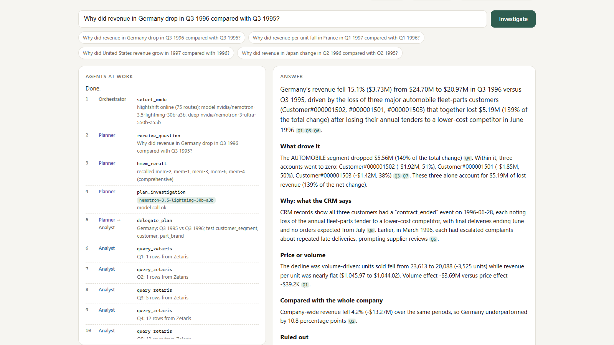
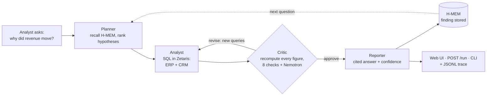
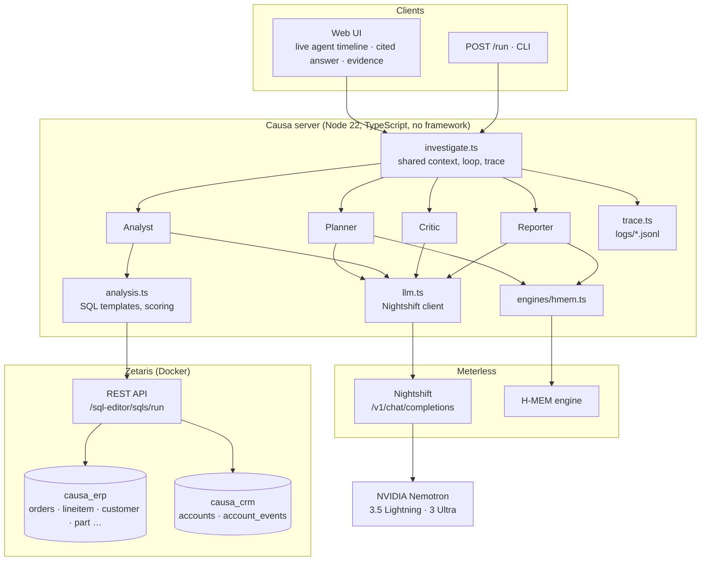
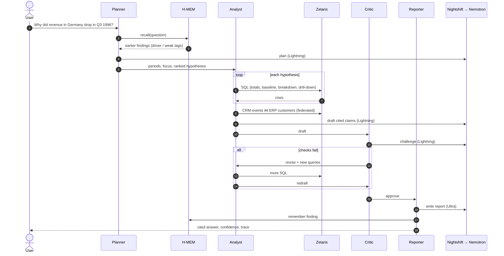

# Causa

**Ask why a number moved. Get an answer you can check.**

Revenue in Germany fell 15% last quarter. Why? Today an analyst spends a day finding out: pulling orders from the ERP, slicing them by segment, product and customer, then searching the CRM for what happened to those accounts. Causa does that investigation with four AI agents and shows its work. The **Planner** recalls past findings and ranks hypotheses. The **Analyst** tests each one with SQL in **Zetaris**, which federates the ERP and the CRM. The **Critic** recomputes every figure and sends the Analyst back for more evidence. The **Reporter** writes an answer where every number links to the query behind it. The reasoning runs on **NVIDIA Nemotron** through **Meterless Nightshift**, and **Meterless H-MEM** remembers what explained earlier changes, so the next investigation starts there.

Built by **Paras Adlakha** and **Harshita Adlakha** for the **Open Agent Hackathon 2026**, Track 2: *The Agent That Can Explain Why*.

**▶️ [Replay real runs in the browser](https://parasadlakha.github.io/causa/app/)** · **🎬 [Narrated 2-minute demo](docs/video/Causa-demo-2min.mp4)** · [3-minute pitch video](docs/video/Causa-pitch-3min.mp4) · [Captioned walkthrough (silent)](docs/video/Causa-demo.mp4) · **📑 [Slides (PDF)](docs/slides/Causa-slides.pdf)** · [PowerPoint](docs/slides/Causa-slides.pptx) · [Project page](https://parasadlakha.github.io/causa/) · [Market brief](docs/market-brief.html)



*A real run on Zetaris and Nemotron ([replay it](https://parasadlakha.github.io/causa/app/)). Left: every agent step as it happened, including the Critic's revision request and the model that answered each call. Right: the answer, where each [Qn] opens the SQL and rows behind it.*

**Contents:** [The hackathon](#the-hackathon) · [The problem](#the-problem) · [What Causa does](#what-causa-does) · [Architecture](#architecture) · [How an investigation works](#how-an-investigation-works) · [The agents](#the-agents) · [Zetaris](#zetaris-the-data-layer) · [Meterless H-MEM](#meterless-h-mem-investigation-memory) · [Nightshift and Nemotron](#meterless-nightshift-and-nvidia-nemotron) · [Evidence and traces](#evidence-and-traces) · [Real runs](#real-runs) · [Tests](#tests) · [Run it yourself](#run-it-yourself) · [Repository layout](#repository-layout) · [What we learned](#what-we-learned) · [Limitations and roadmap](#limitations-and-roadmap) · [Pre-existing components](#pre-existing-components) · [Team](#team) · [References](#references)

---

## The hackathon

| | |
|---|---|
| **Event** | Open Agent Hackathon 2026, on HackOS |
| **Dates** | 22–27 October 2026; submissions close 27 October, 23:45 UTC |
| **Track** | 2: *The Agent That Can Explain Why*: investigate a complex question across several sources and produce evidence-backed answers |
| **Must use** | Zetaris as the data layer · at least one Meterless Engine in a working feature · Meterless Nightshift as the primary AI provider · NVIDIA through Nightshift where it helps |
| **Agent bar** | Planner, executor and evaluator, with critique, revision, shared state and branching or retry. A fixed A→B→C chain doesn't qualify |
| **Judging** | Impact 30 · Technical 20 · Innovation 15 · Demo 15 · Product & UX 10 · Sponsor tech 10 |

### What the rules ask for, and where it is in Causa

| Requirement | Causa |
|---|---|
| Zetaris is the data layer, queried over REST | Every live query goes to `POST /sql-editor/sqls/run`; the ERP and CRM are Zetaris data sources ([`src/data/zetaris.ts`](src/data/zetaris.ts)) |
| Automated source registration | [`scripts/register_zetaris_sources.sql`](scripts/register_zetaris_sources.sql), run by `npm run zetaris:register` |
| A Meterless Engine powers a working feature, with a passing test | H-MEM investigation memory: recalled findings reorder the next plan; feedback adjusts trust ([tests](test/pipeline.test.ts), conformance 13/13) |
| Nightshift is the primary AI provider | The only model endpoint, with the `meterless-app` and `meterless-scope: user` headers ([`src/llm.ts`](src/llm.ts)) |
| NVIDIA / DGX Spark award: Nemotron powers a feature, logs show the model | Nemotron 3.5 Lightning (plan, draft, critique) and Nemotron 3 Ultra (report); the `model` field in every trace event |
| Planner, executor, evaluator; critique, revision, retry | Planner → Analyst ⇄ Critic → Reporter, up to 2 revisions, JSON retry, provider retry, fallbacks |
| Programmatic entry point | `POST /run`, plus a CLI |
| Evidence of how it reached the output | A JSONL trace per run; the example traces are committed |
| 3+ input and output examples from real runs | [`input_examples/`](input_examples), [`output_examples/`](output_examples) (4 each) |
| `SAMPLE_MODE` with no prewritten answers | `SAMPLE_MODE=true` swaps Zetaris for SQLite on the same seed; answers are still computed |
| `data/README.md` | Source, licence, record counts, registration, regeneration ([`data/README.md`](data/README.md)) |
| No committed secrets | `.env` is git-ignored; the git history was scanned for the real key, password and token |

---

## The problem

"Why did this number move?" is asked in every monthly business review, and answering it is slow.

- The **FP&A Trends Survey 2024**, of more than 2,400 finance practitioners, found that only **35% of FP&A time is spent generating insights**, while **45% goes on non-value-adding work** such as data collection and validation.
- The answer to a revenue change almost always spans **two systems**. The ERP shows *what* moved: which segment, product or customer. The CRM shows *why*: a lost tender, a discount programme, a new contract. Few tools join the two.
- **BI "explain" features** such as Power BI's *Explain the increase*, Tableau's *Explain Data* and ThoughtSpot SpotIQ find statistical drivers inside one dataset. They don't fetch the business reason or challenge their own findings. **Chat-with-your-data assistants** write a fluent paragraph from one-shot SQL, with nothing guaranteeing that a number in the text matches a query.

**Our bet:** an investigation is a loop, not a lookup. Plan the hypotheses, test each one with SQL, have a critic check every figure and demand what's missing, and only then write the answer, with the evidence attached. Remember what worked, so the next investigation starts smarter.

---

## What Causa does



| Step | What happens | Powered by |
|---|---|---|
| **Ask** | "Why did revenue in Germany drop in Q3 1996 compared with Q3 1995?" | Web UI, `POST /run` or CLI |
| **Plan** | H-MEM recall; the two periods, the focus (`customer_nation = GERMANY`) and up to 5 ranked hypotheses, each with a reason | Nemotron 3.5 Lightning, H-MEM |
| **Test** | Totals with a price/volume split, a company-wide baseline, a breakdown per hypothesis scored against the overall trend, a drill-down into the dominant driver, and the CRM events of the accounts behind it | Zetaris (federated SQL) |
| **Challenge** | Every claim must cite a query that ran, and every figure must match it. Also checked: compared with the baseline, price and volume separated, driver drilled into, CRM consulted, secondary drivers tested for confounding. Nemotron adds a free-form challenge | Nemotron 3.5 Lightning |
| **Revise** | The Analyst runs the queries the Critic asked for and redrafts (up to 2 rounds) | Zetaris, Nemotron |
| **Answer** | A Markdown answer with `[Qn]` citations and a confidence score with its reasons. A guard rejects any figure that isn't in the approved claims or their queries | Nemotron 3 Ultra |
| **Remember** | The finding is stored with `driver:` and `weak:` tags; Helpful/Wrong feedback adjusts its trust | H-MEM |

---

## Architecture



**Why it is built this way**

- **The model reasons; SQL computes.** Every number comes from a query template filled in by the agents, never from model arithmetic. The model chooses what to test and how to explain it, and the Critic checks each figure against the rows.
- **Trust nothing the model writes.** Plans and claims are validated JSON. Figures are matched to their cited queries. The report guard rejects any number outside the approved evidence, and model reasoning (`</think>`) is stripped.
- **The Critic has a veto.** The answer isn't released until the draft passes, or the revision budget is spent. Any open points are then listed in the answer.
- **Every part runs without services.** With `SAMPLE_MODE=true` and `CAUSA_OFFLINE=true`, the same pipeline runs on SQLite with rule-based agents, and the trace says so.

---

## How an investigation works



---

## The agents

| Agent | Role | Input | Output | Model (live) |
|---|---|---|---|---|
| **Planner** | Scope and hypotheses | Question, H-MEM recall | Periods, focus, ≤5 ranked hypotheses with reasons | Nemotron 3.5 Lightning |
| **Analyst** (executor) | Run SQL, draft claims | Plan; the Critic's requests | Queries with rows; claims citing query ids | Nemotron 3.5 Lightning |
| **Critic** (evaluator) | Validate and challenge | Draft, queries | 8 checks, issues, new query requests; approve or revise | Nemotron 3.5 Lightning |
| **Reporter** | Answer and remember | Approved claims, queries, critiques | Cited report, confidence, H-MEM record | Nemotron 3 Ultra |

**Collaboration:** delegation (Planner → Analyst) · critique · revision loop with new queries · shared memory across runs (H-MEM) and a shared context within a run · branching (hypothesis order depends on memory; the drill-down depends on the dominant driver) · retry (invalid JSON goes back to the model with the error; a provider 5xx is retried once) · fallback (a failed model step uses computed claims; an unreachable Nightshift switches to rule-based agents) · confidence scoring with reasons · human feedback into H-MEM.

**Confidence is earned, not asserted.** It starts at 45% and rises for a concentrated driver, CRM corroboration, a drill-down, a baseline comparison and passing checks. It falls for open critic points, and by 25 points when no contract, tender or pricing event in the CRM explains the drivers. That last case means the *what* is known but the *why* isn't.

---

## Zetaris: the data layer

| What | How | Code |
|---|---|---|
| **Two sources** | Postgres databases `erp` and `crm` in the `causa-db` container on the Zetaris Docker network | [`docker-compose.yml`](docker-compose.yml) |
| **Registration** | `CREATE DATASOURCE causa_erp … OPTIONS (jdbcdriver, jdbcurl, username, password)` then `REGISTER DATASOURCE TABLES FROM causa_erp`; the same for `causa_crm` | [`scripts/register_zetaris_sources.sql`](scripts/register_zetaris_sources.sql) |
| **Queries** | `POST /api/v1.0/sql-editor/sqls/run` with the API key and org id; tables addressed as `causa_erp.lineitem`, `causa_crm.account_events` | [`src/data/zetaris.ts`](src/data/zetaris.ts) |
| **Federation** | The CRM step joins `causa_crm.account_events` to `causa_erp.customer` and `causa_erp.nation` in one statement | `crmSql` in [`src/analysis.ts`](src/analysis.ts) |
| **Visible** | Every query, its SQL, row count and timing is in the trace and in the UI's evidence panel | |

A live investigation sends 7–11 queries to Zetaris. `npm run zetaris:register` finishes with a federated check, for example: `921 CRM events joined to ERP customers`.

## Meterless H-MEM: investigation memory

**The engine-powered feature: Causa learns which explanations work.**

- **Remember:** after each investigation the Reporter stores a finding, for example *"Germany, Q3 1995 vs Q3 1996: −15.1% (−$3.73M). Explained by customer market segment (Automobile)… Not the cause: part brand…"*. It is tagged `driver:customer_segment`, `weak:part_brand` and `focus:germany`, with provenance pointing to the trace and query ids.
- **Recall:** the Planner queries H-MEM with each new question. Dimensions that explained earlier changes are tested first, and ruled-out ones last as controls, with "recalled from memory" given as the reason in the plan.
- **Feedback:** the UI's Helpful/Wrong buttons call H-MEM `feedback`, which updates the memory's confidence through the trust ledger.
- **Proof:** [`test/pipeline.test.ts`](test/pipeline.test.ts) shows a Germany finding recalled by a follow-up question and moving `customer_segment` to the first hypothesis, and shows feedback lowering confidence. `npm run conformance` runs the official H-MEM conformance suite against the engine Causa imports: **13/13**.

## Meterless Nightshift and NVIDIA Nemotron

| What | How |
|---|---|
| **Endpoint** | `POST http://127.0.0.1:8088/v1/chat/completions`, OpenAI-compatible; the only AI provider in the code |
| **Headers** | `Authorization: Bearer <runtime token>`, `meterless-app: causa`, `meterless-scope: user`, `meterless-ttfb-ms: 240000` |
| **Token** | Read from the runtime's own `proxy-token` file, so it is never copied by hand |
| **Health** | `GET /v1/models`; if Nightshift is unreachable, rule-based agents take over and the trace logs `select_mode … fallback` |
| **Models** | `nvidia/nemotron-3.5-lightning-30b-a3b` for planning, drafting and critique; `nvidia/nemotron-3-ultra-550b-a55b` for the report; both as Nightshift lanes |
| **Model per call** | Each model step's trace event records the model Nightshift reports, with duration and retry count |

---

## Evidence and traces

Every run writes `logs/trace-<time>-<id>.jsonl`. One line from the Germany run:

```json
{"step":16,"agent":"CriticAgent","action":"request_revision","target_agent":"AnalystAgent","status":"success",
 "output_summary":"round 1: 6/8 checks passed, 2 new queries asked, 4 issues","detail":{"checks":[…]}}
```

Data steps carry the query id and SQL. Model steps carry `model`, `duration_ms` and `retry_count`. The UI streams the same events live, and `POST /run` returns the full result: plan, queries with rows, critiques, report, memory ids, models used and trace path.

---

## Real runs

All four ran live on Zetaris with Nemotron through Nightshift. Full results, readable answers and traces are in [`output_examples/`](output_examples). Causa never reads them, and a test checks that.

| Question | Change | What Causa found | Confidence | Queries | Revisions | Time | Files |
|---|---|---|---|---|---|---|---|
| Germany, Q3 1996 vs Q3 1995 | -15.1% | Three Automobile accounts lost their fleet-parts tender to a cheaper competitor (CRM, 28 June 1996) | 95% | 9 | 1 | 10 min | [answer](output_examples/germany_q3_1996.md) · [JSON](output_examples/germany_q3_1996.json) · [trace](output_examples/germany_q3_1996.trace.jsonl) |
| France, Q1 1997 vs Q1 1996 | +2.5% | Revenue per unit −9%: a winter volume-discount programme (CRM: price renegotiated); more units at less revenue each | 85% | 11 | 2 | 12 min | [answer](output_examples/france_q1_1997.md) · [JSON](output_examples/france_q1_1997.json) · [trace](output_examples/france_q1_1997.trace.jsonl) |
| United States, 1997 vs 1996 | +6.5% | Two Machinery customers won in December 1996 added $15.6M while other segments slipped (CRM: new contract) | 95% | 8 | 1 | 7 min | [answer](output_examples/united_states_1997.md) · [JSON](output_examples/united_states_1997.json) · [trace](output_examples/united_states_1997.trace.jsonl) |
| Japan, Q2 1996 vs Q2 1995 (control) | -16.1% | A real drop spread across accounts; no contract, tender or pricing event in the CRM, so the cause is reported as not established | 70% | 10 | 1 | 9 min | [answer](output_examples/japan_q2_1996_control.md) · [JSON](output_examples/japan_q2_1996_control.json) · [trace](output_examples/japan_q2_1996_control.trace.jsonl) |

The data has three planted stories, and the agents are never told about them. Japan is a control with none: Causa reports a real drop but doesn't invent a cause.

---

## Tests

```bash
npm test               # 9 pipeline tests in SAMPLE_MODE: no services needed (about 40 s)
npm run conformance    # official Meterless H-MEM conformance suite against Causa's engine (13/13)
```

| Test | What it proves |
|---|---|
| H-MEM: remembered, recalled, moves hypotheses | The engine-powered feature works end to end |
| H-MEM: feedback changes confidence | UI feedback reaches the trust ledger |
| Anti-hardcoding: totals equal an independent SQL query | Report figures come from the data |
| Anti-hardcoding: different questions, different answers | Germany (lost volume) and France (discount-driven price fall) are explained differently, from the data |
| Anti-hardcoding: runtime never reads example outputs | No canned answers |
| Control question isn't reported with high confidence | An unexplained change scores lower than a corroborated one, and says why |
| Trace: 4 agents, a critique, handoffs, every query | The agent activity is real and logged |
| Germany story found | The planted cause is found without being given to the agent |
| `stripReasoning` | Nemotron's inline reasoning never reaches an answer |

---

## Run it yourself

**Requirements:** Node.js 22.13 or later. For live mode: Docker, the Zetaris local platform, and Meterless Nightshift with a Nemotron lane.

**No services (about 15 seconds per question):**

```bash
git clone https://github.com/ParasAdlakha/causa.git
cd causa
npm ci
npm test
SAMPLE_MODE=true CAUSA_OFFLINE=true npm start     # http://localhost:3100
```

On Windows PowerShell: `$env:SAMPLE_MODE="true"; $env:CAUSA_OFFLINE="true"; npm start`.

**Live: Zetaris and Nemotron**

1. **Zetaris:** download the local platform from Zetaris Cloud ("Run locally"), `docker compose up -d` in it, sign in at http://localhost:3000, and create an API key in the user menu.
2. **Nightshift:** install Meterless Nightshift, add your NVIDIA key under *Setup → Providers*, and add a Nemotron lane (for example *Nemotron 3.5 Lightning*). Add *Nemotron 3 Ultra* too, for the report.
3. **Configure:** `cp .env.example .env` and set `ZETARIS_API_KEY` and `CAUSA_DB_PASSWORD`. On the machine running Nightshift, Causa finds the runtime token by itself.
4. **Data:**
   ```bash
   docker compose up -d          # causa-db: ERP + CRM Postgres, joined to the Zetaris network
   npm run zetaris:register      # registers causa_erp and causa_crm, then a federated check
   npm run status                # data layer: zetaris -> online · nightshift -> online
   ```
5. **Run:** `npm start` and open http://localhost:3100. A live investigation takes 7–16 minutes on a laptop.

**Use it from code:**

```bash
curl -X POST http://localhost:3100/run -H "Content-Type: application/json" \
  -d '{"question": "Why did revenue in Germany drop in Q3 1996 compared with Q3 1995?"}'
npm run investigate -- "Why did United States revenue grow in 1997 compared with 1996?"
npm run examples              # re-runs input_examples/ into output_examples/
```

**Docker:** the [`Dockerfile`](Dockerfile) header shows how to run the app in a container against Zetaris and Nightshift on the host (`host.docker.internal`), or in sample mode.

---

## Repository layout

```
src/
  investigate.ts      The loop: Planner → Analyst ⇄ Critic → Reporter → H-MEM, shared context, trace
  agents/planner.ts   Periods, focus and ranked hypotheses (model or rules), H-MEM recall
  agents/analyst.ts   Runs the SQL plan, drafts and redrafts cited claims
  agents/critic.ts    8 checks, figure matching, Nemotron challenge, revision requests
  agents/reporter.ts  Cited report, figure guard, confidence with reasons, H-MEM write
  analysis.ts         SQL templates (totals, baseline, breakdowns, federated CRM), trend scoring
  data/zetaris.ts     Zetaris REST client
  data/warehouse.ts   Zetaris or SAMPLE_MODE SQLite behind one interface
  engines/hmem.ts     Investigation memory on Meterless H-MEM
  llm.ts              Nightshift client: headers, token, retry, reasoning strip
  trace.ts            JSONL trace
  server.ts           Web UI, POST /run, live event stream, feedback
  cli.ts              Command line
public/index.html     The web UI
scripts/              Data generator, Zetaris registration (SQL + runner), examples, conformance
docker/initdb/        ERP and CRM database dumps loaded by causa-db
data/                 Seed for SAMPLE_MODE and the data README
vendor/hmem/          Meterless H-MEM reference engine and conformance suite (Apache-2.0)
input_examples/       Questions; output_examples/ holds real results and traces
test/                 Pipeline and unit tests
docs/                 Project page, replay app (docs/app), slides, videos, screenshots, market brief, submission texts
```

---

## What we learned

- **The Critic is the product.** A fluent first draft was easy. The first revision was where answers got right: the Critic asking "did you drill into the driver?" and "did you check those accounts in the CRM?" is what turned a segment-level guess into a named tender loss.
- **Let SQL do the arithmetic.** Once every figure had to match a cited query, the model's job became choosing what to test and how to say it. It never computes. That also made the anti-hardcoding tests straightforward.
- **A guard against new numbers needs to allow sums.** The Reporter's figure guard first rejected Nemotron Ultra's correct "the three accounts together lost $5.19M", because the total wasn't in any single claim. Allowing values from the cited queries, and sums of two or three of them, fixed it without letting invented numbers through.
- **Confidence has to fall when the "why" is missing.** Our control question scored 95% at first: a big driver, a drill-down and passing checks, but nothing in the CRM. Now no commercial event means minus 25 points, and the report says the cause isn't established.
- **Reasoning models need time, and the right header.** Nemotron reasons before its first token, and Nightshift stops a cloud lane after 45 seconds by default. The per-request override is `meterless-ttfb-ms` (up to 300000), not `meterless-ttfb`. Ultra also returns its reasoning inline, ending in `</think>`, so we strip everything before it.
- **Zetaris registration is plain SQL.** `CREATE DATASOURCE <name> DESCRIBE BY "…" OPTIONS (jdbcdriver …, jdbcurl …, username …, password …)` then `REGISTER DATASOURCE TABLES FROM <name>`. Descriptions accept only letters, digits and `_ . - ,`. A Postgres container on the Zetaris Docker network is reachable by its container name.
- **On a 12 GB laptop, memory is the scheduler.** Zetaris (Spark), Docker and Nightshift together leave little headroom. Nightshift's graphics-card probe hung after a memory-pressure reboot. Ending the stuck `llama-server --list-devices` process let it start in CPU mode.

---

## Limitations and roadmap

**Limitations today**
- **Revenue only:** the question must be about revenue for one focus (a country, region or segment) between two periods.
- **Synthetic data with planted stories:** real data will produce more ambiguous drivers. A random dimension sometimes clears the significance test, as order priority did in the France run. The Critic doesn't yet judge whether a driver is plausible in business terms, and there's no multiple-comparisons correction.
- **Speed:** a live run takes 7–16 minutes on a laptop with hosted reasoning models. The rule-based mode takes about 15 seconds.
- **One investigation at a time** per server, and no user accounts.
- **Evidence, not proof:** a matching CRM event supports a cause but doesn't prove it. The report says what it found and its confidence.

**Roadmap**
- **More metrics:** margin, churn, pipeline and inventory, as SQL templates the Planner can choose.
- **Real sources:** SAP, Salesforce and HubSpot through Zetaris connectors, with no data copies.
- **Statistical rigour:** a multiple-comparisons correction, and a Critic check for business plausibility.
- **Faster:** a local Nemotron lane for the Critic, and parallel breakdown queries.
- **Scheduled:** investigate every material variance before the monthly review, and post the answers where the team works.

---

## Pre-existing components

- [`vendor/hmem`](vendor/hmem): the Meterless H-MEM reference implementation and conformance suite (Apache-2.0, upstream commit in `vendor/hmem/UPSTREAM_COMMIT`), used unchanged.
- Everything else, including the agents, the server and UI, the data generator and the data, was written during the hackathon, 25–27 October 2026. No data was prepared before 22 October.

## Team

| | Background | Role on Causa |
|---|---|---|
| **Paras Adlakha** | Aerospace, electronics, systems engineering | Agents, Zetaris data layer, Meterless and Nemotron integrations |
| **Harshita Adlakha** | System dynamics, socio-technical systems | Research, problem framing, evaluation design and the demo story |

Built with Claude Code.

## References

- FP&A Trends, [2024 FP&A Trends Survey results](https://fpa-trends.com/article/2024-fpa-trends-survey-results-unveiled): more than 2,400 respondents; 35% of FP&A time on insights, 45% on non-value-adding activities.
- Market size, directional: [Custom Market Insights, cloud FP&A solution market](https://www.custommarketinsights.com/report/cloud-financial-planning-and-analysis-solution-market/) (≈ USD 2.6 billion in 2025). Broader "financial planning software" estimates range from about USD 4.9 to 6.8 billion; definitions differ.
- [TPC-H benchmark](https://www.tpc.org/tpch/), whose schema the synthetic ERP follows.
- Sponsor documentation: Zetaris local platform and REST API · Meterless H-MEM, Nightshift and the Meterless Runtime provider contract · [NVIDIA Nemotron](https://build.nvidia.com/).

## Licence

Apache-2.0.

---

*Causa is a hackathon prototype on synthetic data. Its answers are evidence-backed estimates, not audited findings.*
