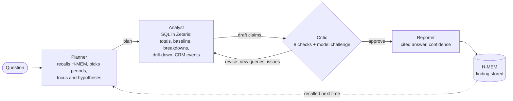

# Causa

**Ask why a number moved. Causa's agents test each explanation against your data and answer with cited evidence.**

> "Why did revenue in Germany drop in Q3 1996?"
>
> Revenue fell 15.1% ($3.73M), almost entirely through lost volume in the Automobile segment. Three accounts stopped ordering after they lost their annual fleet-parts tender to a cheaper competitor on 28 June 1996 (CRM), after escalating late deliveries in March. [Q1][Q3][Q6]

Every number in that answer comes from a SQL query the agents ran in **Zetaris**, across an ERP database and a CRM database. A critic agent checks every claim against its query before the answer is released. The planning, drafting and critique run on **NVIDIA Nemotron** through **Meterless Nightshift**, and **Meterless H-MEM** remembers what explained earlier changes, so the next investigation starts there. Every step is written to a JSONL trace.

Built for the Open Agent Hackathon 2026, Track 2: *The Agent That Can Explain Why*.

---

## Why this matters

Every month, finance and sales-ops teams get the same question: *why is this number different from last time?* Answering it means pulling orders from the ERP, slicing them a dozen ways, spotting which slice moved, then searching the CRM for what happened to those accounts. That takes an analyst a day. The common shortcut, a dashboard plus a guess, is how bad decisions get made.

Causa does the full investigation in a few minutes and shows its work: the plan, every query, the critic's objections and the revisions. Each claim links to the rows behind it, so the answer can be checked, not just trusted.

## How it works



| Agent | Role | Model (live) |
|---|---|---|
| **Planner** | Recalls past findings from H-MEM, works out the two periods and the focus (for example `customer_nation = GERMANY`), and ranks hypotheses. Dimensions that explained earlier changes go first; ones ruled out before go last as controls. | Nemotron 3.5 Lightning |
| **Analyst** (executor) | Runs SQL through Zetaris: totals and a price/volume split, a company-wide baseline, a breakdown per hypothesis (each value scored against the overall trend), a drill-down into the dominant driver, and the CRM events of the accounts behind it. Drafts claims, each citing query ids. | Nemotron 3.5 Lightning |
| **Critic** (evaluator) | Checks the draft: every claim cites a query that ran, every figure matches its query, compared with the company-wide trend, price and volume separated, dominant driver drilled into, driver accounts checked in the CRM, secondary drivers tested for confounding. Nemotron adds a free-form challenge. It either asks for new queries and a revision, or approves. | Nemotron 3.5 Lightning |
| **Reporter** | Writes the cited answer and a confidence score with its reasons. A guard rejects any figure that isn't in the approved claims or their queries, and falls back to a template report if needed. Stores the finding in H-MEM. | Nemotron 3 Ultra 550B |

**Not a fixed chain.** The Critic loops back to the Analyst with new queries (up to 2 revisions). The Planner's hypothesis order branches on memory. Every model call retries once with the validation error when its JSON is invalid. If Nightshift is unreachable, rule-based agents take over and the trace says so. The shared state (plan, queries, totals, claims, critiques) lives in one context that all four agents read and write.

## Sponsor technology

| | How Causa uses it | Where |
|---|---|---|
| **Zetaris** (data layer) | The only data path in live mode. Two Postgres databases are registered as the `causa_erp` and `causa_crm` data sources, and every query goes to `POST /sql-editor/sqls/run`. The CRM step joins `causa_crm.account_events` to `causa_erp.customer` in one federated query. | [`src/data/zetaris.ts`](src/data/zetaris.ts), [`scripts/register_zetaris_sources.sql`](scripts/register_zetaris_sources.sql) |
| **Meterless H-MEM** (engine) | Investigation memory. The Reporter stores each finding tagged with the dimensions that explained it (`driver:…`) and the ones that didn't (`weak:…`). The Planner recalls them and reorders its hypotheses. Thumbs up/down in the UI feeds H-MEM's trust ledger. Passes the official conformance suite (13/13) and Causa's own tests. | [`src/engines/hmem.ts`](src/engines/hmem.ts), [`vendor/hmem`](vendor/hmem) |
| **Meterless Nightshift** (AI provider) | Every model call goes to Nightshift's OpenAI-compatible `/v1/chat/completions` with the `meterless-app: causa` and `meterless-scope: user` headers. The token is read from the runtime's own `proxy-token` file. | [`src/llm.ts`](src/llm.ts) |
| **NVIDIA Nemotron** | Lanes in Nightshift: `nvidia/nemotron-3.5-lightning-30b-a3b` for planning, drafting and critique, and `nvidia/nemotron-3-ultra-550b-a55b` for the final report. The trace records the model that actually answered each call. | traces in [`output_examples/`](output_examples) |

## Quick start: no services needed

Needs Node.js 22.13 or later.

```bash
git clone <this repo> && cd causa
npm ci
SAMPLE_MODE=true CAUSA_OFFLINE=true npm start     # then open http://localhost:3100
```

`SAMPLE_MODE=true` loads the bundled seed data into in-memory SQLite instead of querying Zetaris. `CAUSA_OFFLINE=true` runs the rule-based agents instead of calling Nightshift. The SQL, the critic loop, H-MEM and the traces are the same code as live mode, and no answers are prewritten: tests compare report figures with independent queries.

On Windows PowerShell, set the variables first: `$env:SAMPLE_MODE="true"; $env:CAUSA_OFFLINE="true"; npm start`.

## Full setup: Zetaris and Nightshift

1. **Zetaris:** download the local platform from Zetaris Cloud ("Run locally"), run `docker compose up -d` in it, and sign in at http://localhost:3000. Create an API key in the user menu.
2. **Nightshift:** install Meterless Nightshift, add your NVIDIA key under *Setup → Providers*, and add a Nemotron lane (for example *Nemotron 3.5 Lightning*).
3. **Configure Causa:**
   ```bash
   cp .env.example .env     # set ZETARIS_API_KEY and CAUSA_DB_PASSWORD
   ```
   On the machine running Nightshift, Causa reads the runtime token by itself. Elsewhere, set `METERLESS_RUNTIME_TOKEN`.
4. **Load the data and register it in Zetaris:**
   ```bash
   docker compose up -d          # causa-db: ERP + CRM Postgres on the Zetaris network
   npm run zetaris:register      # runs scripts/register_zetaris_sources.sql
   npm run status                # data layer: zetaris -> online, nightshift -> online
   ```
5. **Run:** `npm start` and open http://localhost:3100.

## Usage

**Web UI** at `/`: type a question or pick an example. The left panel streams each agent step live, including which Nemotron model answered. The answer's `[Qn]` citations open the exact SQL and result rows.

**HTTP**, for scripts and judges:

```bash
curl -X POST http://localhost:3100/run -H "Content-Type: application/json" \
  -d '{"question": "Why did revenue in Germany drop in Q3 1996 compared with Q3 1995?"}'
```

It returns the plan, every query (SQL and rows), every critique, the report, the memory ids, the models used and the trace path. `GET /api/status` reports both services. `GET /api/stream?question=…` streams the same run as server-sent events.

**CLI:** `npm run investigate -- "Why did United States revenue grow in 1997?"`, or `npm run examples` to re-run everything in `input_examples/`.

**Docker:** see the [`Dockerfile`](Dockerfile) header. Zetaris and Nightshift are reached through `host.docker.internal`.

## Evidence of how it reached each answer

Each run writes `logs/trace-<time>-<id>.jsonl`, one event per step: agent, action, handoff target, status, retry count, duration, the query id and SQL for data steps, and the model that answered for model steps. The traces of the example runs are committed next to their outputs.

## Examples (real runs)

`input_examples/` holds the questions. `output_examples/` holds the full JSON result, a readable `.md` answer and the `.trace.jsonl` of a live run on Zetaris with Nemotron. The outputs are a record of those runs only: Causa never reads them, and a test checks that.

<!-- EXAMPLES TABLE -->

## Tests

```bash
npm test               # pipeline tests in SAMPLE_MODE: no services needed (about 30 s)
npm run conformance    # official Meterless H-MEM conformance suite against Causa's engine
```

| Test | What it proves |
|---|---|
| H-MEM: remembered, recalled, moves hypotheses | The engine-powered feature works: a finding from one investigation is recalled by the next plan and changes which hypothesis is tested first |
| H-MEM: feedback changes confidence | UI feedback reaches the trust ledger |
| Anti-hardcoding: totals equal an independent SQL query | Report figures come from the data |
| Anti-hardcoding: different questions, different answers | Germany (volume loss) and France (discount-driven price fall) get different, data-derived explanations |
| Anti-hardcoding: runtime never reads example outputs | No canned answers |
| Trace: 3+ agents, critique, handoffs, every query | The agent activity is real and logged |
| Germany story found | The planted cause is found without being given to the agent |
| `stripReasoning` | Nemotron's inline reasoning never leaks into answers |

## Data

A synthetic distributor (TPC-H schema, 1995–1997) with an ERP and a CRM. 187,679 rows, generated from a fixed seed, with three planted business stories as ground truth. See [`data/README.md`](data/README.md).

## Limitations

- **Revenue variance only:** the question has to be about revenue for one focus (a country, region or segment) between two periods. Other metrics need new SQL templates.
- **Synthetic data:** the planted stories are clean, so real data would produce more ambiguous drivers. Order priority sometimes surfaces as a statistically significant but meaningless "driver" (seen in the France run). The critic doesn't yet judge business plausibility.
- **Speed:** a live run takes 7–9 minutes on a laptop, because hosted Nemotron models reason before answering. The rule-based mode takes about 15 seconds.
- **One investigation at a time** per server.
- **Correlation, not proof:** the CRM provides the "why", but a matching event is evidence, not proof of cause. The report says what it found, not more.

## Pre-existing components

- [`vendor/hmem`](vendor/hmem): the Meterless H-MEM reference implementation and conformance suite (Apache-2.0, upstream commit in `vendor/hmem/UPSTREAM_COMMIT`), used unchanged.
- Everything else, including the data generator and the data, was written during the hackathon (25–27 October 2026).

## Licence

Apache-2.0.
